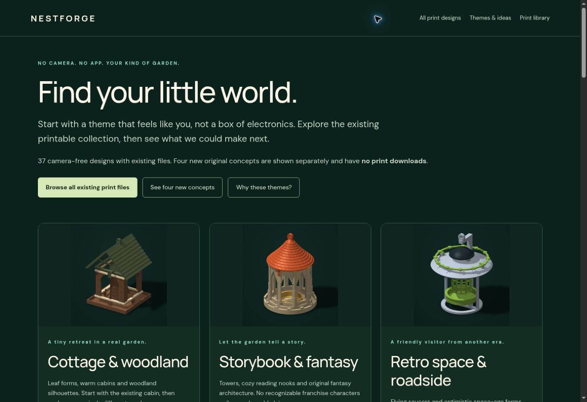
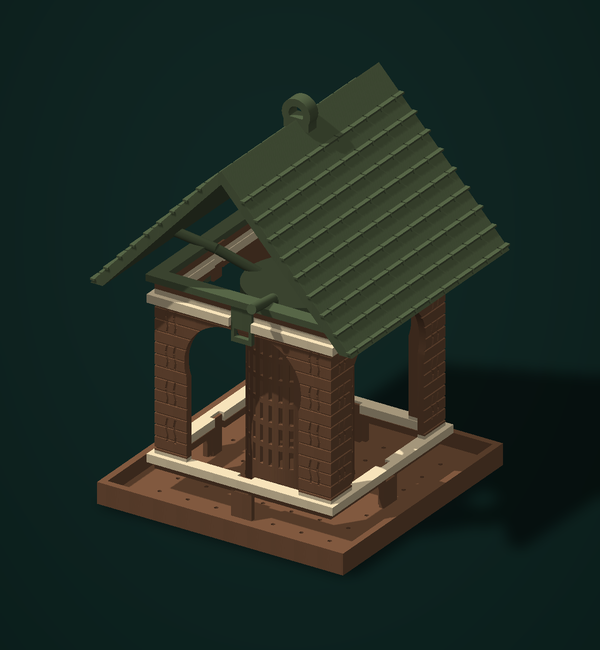
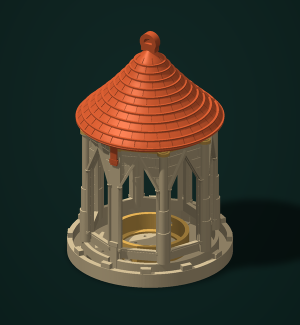
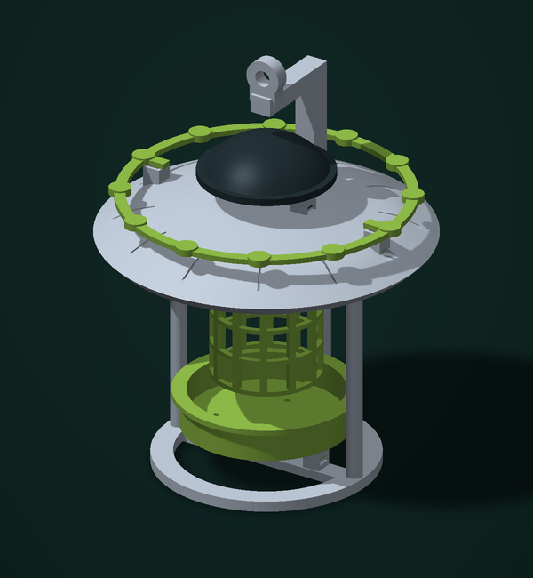
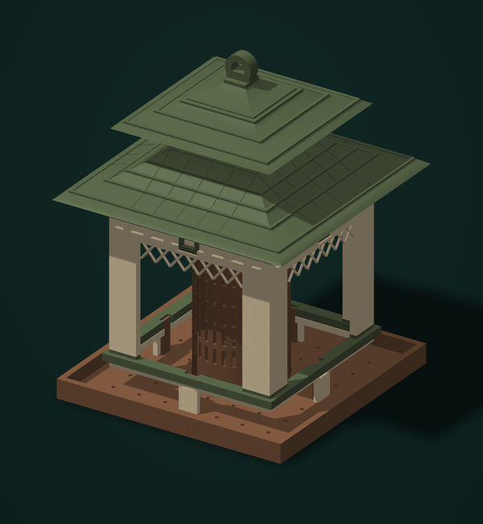
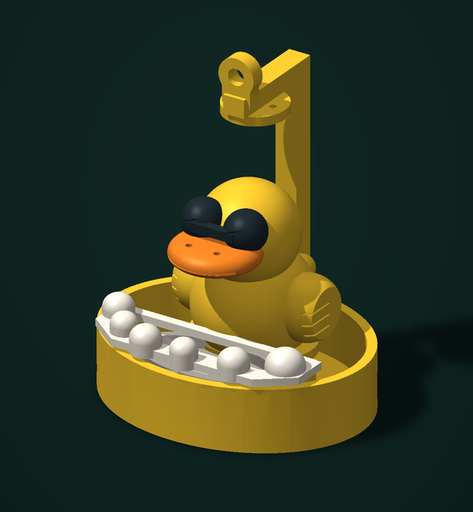
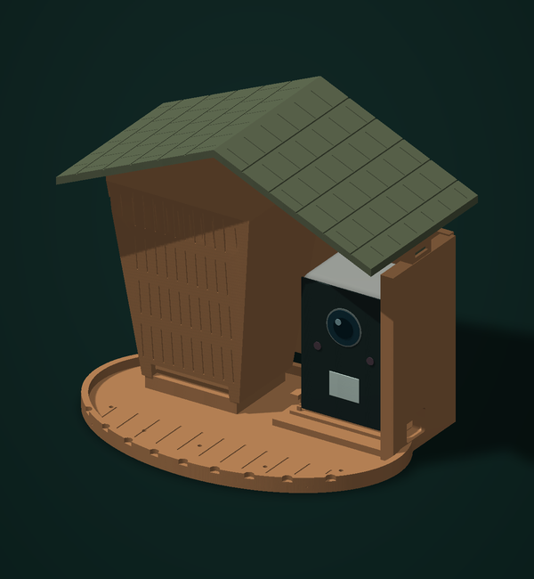
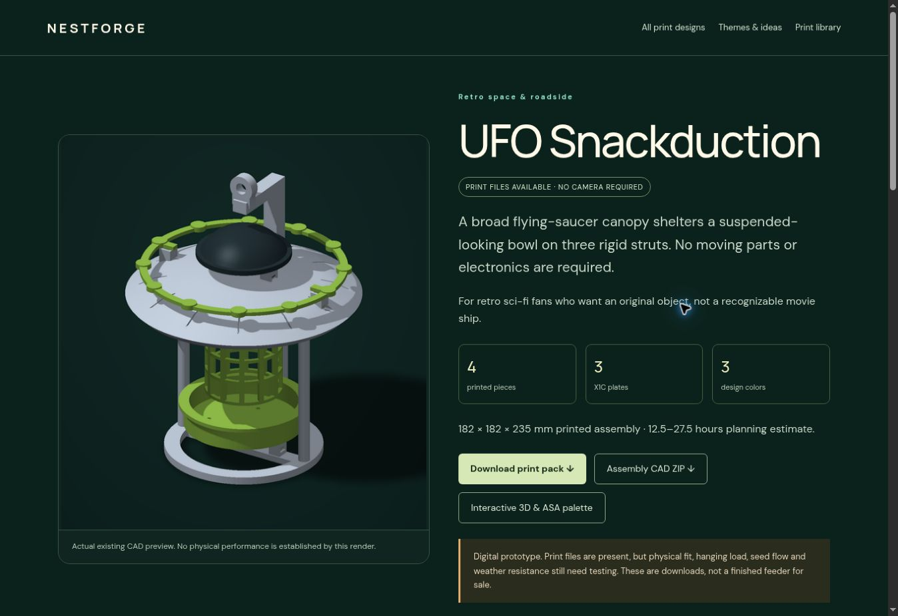
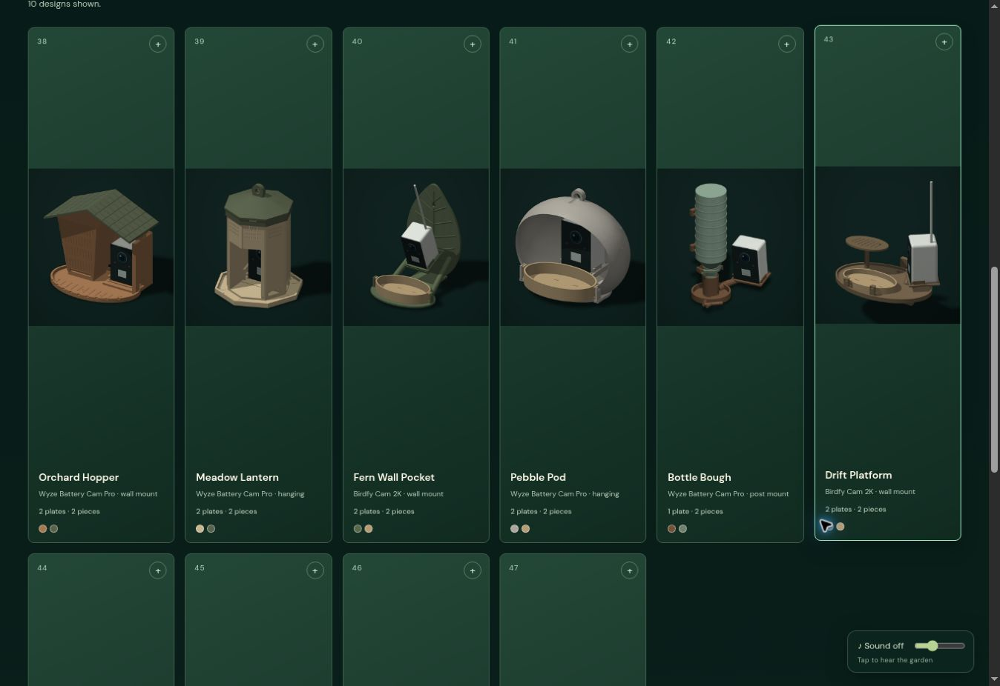
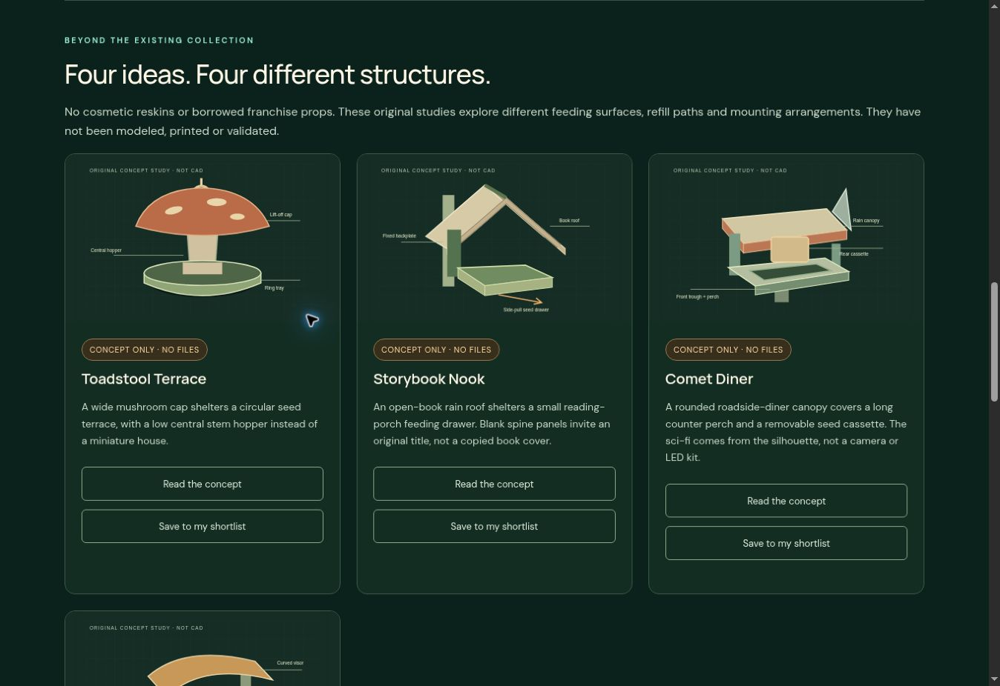

# 🐦 NestForge

### Little worlds. Wild birds.

**A colorful collection of 3D-printable bird feeders, editable CAD, and a complete interactive design library.** Created by [Stephen Shaffer](https://www.linkedin.com/in/stephenshaffer-rd/).

**[Download the complete collection · 504 MB ZIP ↓](https://github.com/thisisformuchfun/nestforge/releases/download/v1.0.0/NestForge-Complete-Collection-v1.0.0.zip)** · **[Release & file details](https://github.com/thisisformuchfun/nestforge/releases/tag/v1.0.0)**

[](https://nestforge-feeders.stevengineer.chatgpt.site/)

    

**[Explore the live collection →](https://nestforge-feeders.stevengineer.chatgpt.site/)** · **[Choose a design](docs/COLLECTION.md)** · **[First print](docs/GETTING_STARTED.md)** · **[CAD & development](docs/DEVELOPMENT.md)**

NestForge brings tiny cabins, castles, lanterns, garden oddities and space-age shapes to the bird feeder. The current collection includes **37 camera-free designs** and **10 camera feeder prototypes**, with their actual geometry, print projects, assembly notes and source. Four additional concept studies explore future directions; they have their own pages and **no CAD or print downloads**.

The **[complete GitHub release](https://github.com/thisisformuchfun/nestforge/releases/download/v1.0.0/NestForge-Complete-Collection-v1.0.0.zip)** contains the entire 1,030-file collection: all model and print packages, STEP/STL/3MF files, website assets, artwork, saved R1/R2 revisions and the October review package. The repository branch keeps the maintained source, catalog, documentation and screenshots easy to browse. Download the complete release for everything, or restore its payload into a clone with `python scripts/fetch-collection.py`.

## A few little worlds

These are **CAD renders**, not photographs of completed prints. Click a name to explore it on the live site, or use the [full 47-design index](docs/COLLECTION.md) for direct print and STEP downloads.

| Cottage & woodland | Storybook & fantasy | Retro space |
|:---:|:---:|:---:|
|  |  |  |
| **[Scandinavian Cabin](https://nestforge-feeders.stevengineer.chatgpt.site/#scandinavian-cabin)** | **[Fairy-tale Turret](https://nestforge-feeders.stevengineer.chatgpt.site/#fairy-tale-turret)** | **[UFO Snackduction](https://nestforge-feeders.stevengineer.chatgpt.site/#ufo-snackduction)** |
| World architecture | Playful garden | Camera prototype |
|  |  |  |
| **[Japanese Pagoda](https://nestforge-feeders.stevengineer.chatgpt.site/#japanese-pagoda)** | **[Rubber Duck Spa](https://nestforge-feeders.stevengineer.chatgpt.site/#rubber-duck-spa)** | **[Orchard Hopper](https://nestforge-feeders.stevengineer.chatgpt.site/#orchard-hopper)** |

## Pick your way in

| I want to… | Start here |
|---|---|
| Download the entire project | [Complete collection ZIP](https://github.com/thisisformuchfun/nestforge/releases/download/v1.0.0/NestForge-Complete-Collection-v1.0.0.zip) |
| Browse shapes, themes and colors | [Live collection](https://nestforge-feeders.stevengineer.chatgpt.site/) |
| Find every design and its downloads | [Complete design index](docs/COLLECTION.md) |
| Print a feeder | [Getting started](docs/GETTING_STARTED.md), then that design’s `-X1C.zip` |
| Edit the solid geometry | That design’s `-STEP.zip`, or [shared CadQuery source](cad-source/cad/) |
| Run or modify the website | [Development guide](docs/DEVELOPMENT.md) |
| See the ideas still on the drawing board | [Four concept studies](https://nestforge-feeders.stevengineer.chatgpt.site/concepts/) |
| Compare earlier revisions | R1, R2 and the October review are in the [complete release](https://github.com/thisisformuchfun/nestforge/releases/tag/v1.0.0) under `archive/` |

### Your first print

1. Choose a design from the [index](docs/COLLECTION.md) and download its **X1C print pack**. Extract it and read `PRINT-GUIDE.html` and the part-specific notes.
2. Open the supplied native **3MF projects in Bambu Studio**. They contain arranged parts and color assignments, and still need slicing. Select the actual printer, nozzle and filament profiles; inspect supports, clearances and the purge tower.
3. Make a small fit trial before committing to a complete build. Check the design’s snap releases, refill path, mounting and drainage with the real printed parts.
4. If you want to change the design, use the separate **STEP download** or the [parametric generators](cad-source/cad/).

The plate target is **Bambu Lab X1 Carbon with a 0.4 mm nozzle**. The collection uses at most **four AMS slots on any one plate**. Some complete designs have six colors spread across different plate loads; the four-slot claim does not mean every whole build has four colors. [More about files and materials →](docs/GETTING_STARTED.md)

## More than a folder of models

The included static website provides family filters, search, sorting, plate budgets, design details, print layouts, assembly notes, dated sourcing information, and an optional 3D viewer. Camera prototypes are available through a deliberate opt-in. The themes section includes a browser-local concept shortlist.



From a Git clone, first restore the collection files, then serve the website:

```sh
python scripts/fetch-collection.py
python -m http.server 8000 --bind 127.0.0.1 --directory dist
```

The fetch helper verifies the pinned release SHA-256 before restoring its artifacts. If you extracted the complete release ZIP, the files are already present and you can skip the fetch step.

Then open **http://127.0.0.1:8000/**. Serving `dist/` avoids the restrictions browsers place on locally opened `file://` pages. There is no website build step. The 3D viewer requires WebGL; the catalog and downloads have a fallback. Nature audio starts only after a deliberate sound action.

## What’s included

| Material | Browsable source branch | Complete release ZIP |
|---|---|---|
| Website | [`dist/`](dist/) HTML, CSS, JavaScript, catalog and editorial pages | Full site, including models, images, fonts, audio and viewer assets |
| Print and CAD exports | [47-design index](docs/COLLECTION.md) with individual download links | All 47 `dist/models/` folders: STEP/STL/3MF, print guides, layouts and stored checks |
| Editable CAD | [`cad-source/`](cad-source/) generators, helpers, briefs and asset notices | Same source plus the attributed sculpt mesh and packaged source ZIP |
| Developer tools | [`scripts/`](scripts/) and [`tests/`](tests/) | Same checks and packaging tools |
| Documentation | [`docs/`](docs/), screenshots and gallery renders | Full documentation and presentation artwork |
| Review evidence | [`review/`](review/) | Review evidence and all referenced preserved artifacts |
| Earlier revisions | [Archive guide](docs/ARCHIVES.md) | Saved R1, R2 and October review files under `archive/` |

**[Get every file in one download →](https://github.com/thisisformuchfun/nestforge/releases/download/v1.0.0/NestForge-Complete-Collection-v1.0.0.zip)** The regular GitHub source ZIP contains the lean branch; use this complete release asset for the full collection.

The retained CAD source also includes **12 historical Vegas-inspired R6 camera feeder designs**. Those generators are preserved as earlier work; they are not the active R7 camera collection or compatible replacement parts for it.

## Camera feeders & future concepts

Ten camera prototypes explore different bodies, seed systems, camera locations and mounting arrangements. Their previews may show purchased equipment for context. Camera hardware is **not printable geometry**, and published camera dimensions do not establish a proven physical fit or usable close focus. Each design records its specific camera target and service path.



**Toadstool Terrace · Storybook Nook · Comet Diner · Courtside Canopy** are separate design studies. Their diagrams communicate proposed structures; no part count, print time or CAD completion is implied.



## Build status

These files describe **digital prototypes**. Stored reports cover geometry, archives, plate placement and native Bambu Studio roundtrips. They do not establish physical snap durability, hanging strength, camera retention/focus, seed flow or outdoor service life. The [verification report](docs/VERIFICATION.md) records the checks run for this repository edition; the [development guide](docs/DEVELOPMENT.md#validation) explains how to reproduce them.

Website print times are planning ranges, not measured print times. Sourcing entries retain their October 2026 observation dates; check the seller’s current listing before buying. [Contributions](CONTRIBUTING.md) with a named design, settings, photos and measured fit results are especially useful.

## Attribution & reuse

No project-wide license grant was present in the recovered collection. This public repository preserves the source and files without declaring a new blanket open-source license.

Dragon Guard Citadel includes an adapted Artec **Fantasy Dragon** sculpt. Its supplied CC BY 3.0 license and modification notes are retained in [community asset credits](cad-source/cad/COMMUNITY-ASSETS.md). That model combines editable structural STEP with a sculpt mesh: the full dragon shape is in the printable meshes/3MF, while STEP contains the mechanical structure. Three.js, fonts and other third-party assets retain their own attribution and license files. See the [attribution index](docs/RIGHTS_AND_ATTRIBUTION.md) and [collection provenance](docs/PROVENANCE.md).

---

**Make a little world. Share what you learn.**
